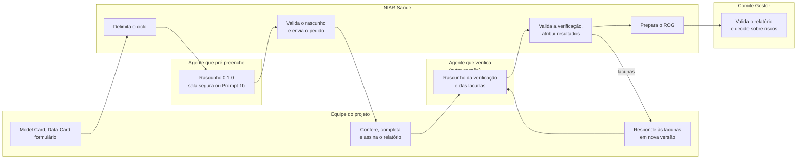
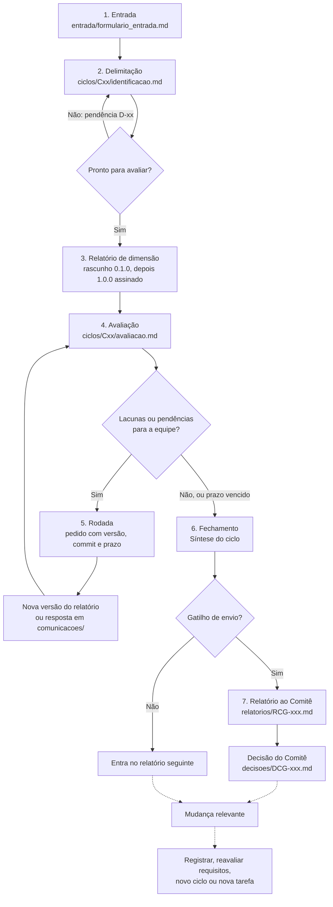
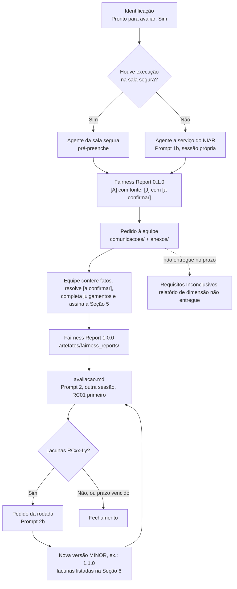
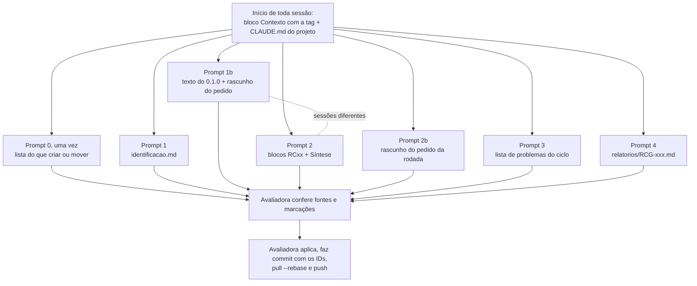

# Como conduzir um ciclo de auditoria do FIAR-Saúde

Guia prático para avaliadoras do NIAR-Saúde. Não cria regras: resume e aponta as regras dos documentos do FIAR. Em caso de dúvida, vale o documento citado. Referência: FIAR-Audit-Template v2.0.5 e FIAR-Saude v2.0.5.

## 1. O que é o ciclo e para que serve

O ciclo é a avaliação de uma unidade: Tarefa de IA + Versão Avaliável + Contexto de Uso, da delimitação ao fechamento (ciclo, Conceitos).

Ele diz, requisito por requisito, se há evidência de práticas de IA Responsável. Cada requisito recebe um resultado: Atendido, Não atendido, Inconclusivo ou Não aplicável (ciclo, Resultados por requisito).

O FIAR-Saúde não é certificação, validação clínica nem autorização de implantação (ciclo, abertura; README do template).

Hoje só a dimensão Justiça está operacionalizada (guia, Status das dimensões).

## 2. Papéis

| Papel | O que faz | Fonte |
| --- | --- | --- |
| Equipe do projeto | Fornece informações e mantém seus artefatos. Confere, completa e assina o relatório de dimensão. Responde às lacunas. | ciclo e guia, Papéis |
| NIAR-Saúde | Delimita o ciclo e decide a aplicabilidade. Verifica o relatório com as evidências, aponta lacunas, atribui resultados, recomenda e prepara o relatório ao Comitê. Não edita artefatos da equipe. | ciclo, Papéis |
| Comitê Gestor | Valida os relatórios do NIAR. Delibera sobre riscos, condicionantes e restrições de uso. Lê a síntese da equipe. Aceitar um risco não muda resultados. | ciclo, Papéis; guia, Encaminhamentos |
| Agente da sala segura | Pré-preenche o relatório de dimensão com a execução, o Model Card e o Data Card. | ciclo, etapa 3 |
| Agente a serviço do NIAR | Sem sala segura, pré-preenche o rascunho. Outro agente pode rascunhar a verificação. | ciclo, Papéis |

**Regra de independência** (ciclo, Papéis; guia, Papéis; prompts, abertura):
- Quem produz e quem verifica são agentes separados, em sessões diferentes.
- Quem pré-preenche o relatório não aponta as lacunas dele.
- Todo texto de agente é validado pela equipe ou pelo NIAR.
- Com duas avaliadoras, quem valida o rascunho pré-preenchido não valida a verificação.

O fluxo de trabalho entre os papéis:

Com duas avaliadoras, a que valida o rascunho não valida a verificação (ciclo, Papéis).

Exemplo: a identificação do DANT traz uma "Nota de independência". Marisa é coautora de uma fonte e pré-preencheu o rascunho, então a validação da verificação fica com Helen.

## 3. As etapas

| Etapa | Entra | Sai | Onde fica | Quem faz | Fonte |
| --- | --- | --- | --- | --- | --- |
| 1. Entrada | Informações da equipe | Formulário de Entrada, aberto uma vez e atualizado quando há mudança relevante | entrada/formulario_entrada.md | Equipe descreve; NIAR ajusta a delimitação | ciclo, etapa 1 |
| 2. Delimitação | Formulário, artefatos, comunicações | Unidade avaliada, Trilha, escopo, fontes F-xx, D-xx, DI-xx, decisão "pronto para avaliar" | ciclos/Cxx/identificacao.md | NIAR | ciclo, etapa 2 |
| 3. Relatório de dimensão | Identificação, Model Card, Data Card, publicações, comunicações, execução | Rascunho 0.1.0 com o pedido; depois relatório assinado 1.0.0 | 0.1.0 em comunicacoes/anexos/; 1.0.0 em artefatos/fairness_reports/ | Agente pré-preenche; equipe confere e assina | ciclo, etapa 3; artefatos/README.md |
| 4. Avaliação | Relatório assinado e demais fontes | Um bloco por requisito, DM-xx e Síntese | ciclos/Cxx/avaliacao.md | NIAR (um agente pode rascunhar) | ciclo, etapa 4 |
| 5. Rodadas | Lacunas e pendências para a equipe | Pedido com versão verificada, commit e prazo; nova versão do relatório; reavaliação | comunicacoes/; nova versão em artefatos/fairness_reports/ | NIAR pede; equipe responde | ciclo e guia, etapa 5 |
| 6. Fechamento | Blocos da avaliação | Resultados, lacunas e pendências remanescentes, limitações, gatilhos | avaliacao.md, Síntese do ciclo | NIAR | ciclo, etapa 6 |
| 7. Relatório ao Comitê | Sínteses e Seção 5 de cada relatório | RCG-xxx; depois a decisão DCG-xxx | relatorios/ e decisoes/ | NIAR prepara; Comitê decide | ciclo, Relatório ao Comitê |

Pontos de atenção:
- **Delimitação.** O contexto avaliado é o atual, por padrão. O uso pretendido fica registrado à parte. A falta de identificador exato da versão vai em "Limitações de identificação" e não é pendência. A delimitação só bloqueia se não der para identificar a tarefa ou ligar as evidências a ela (ciclo, etapa 2; prompts, Prompt 1).
- **Avaliação.** A aplicabilidade vem primeiro, com justificativa, e RC01 antes dos demais. O avaliacao.md aponta para os campos do relatório e não reescreve os fatos (guia, Etapas).
- **Rodadas.** Vencido o prazo, o NIAR conclui com o que houver. Se o relatório não chegar no prazo, os requisitos ficam Inconclusivos, com o motivo "relatório de dimensão não entregue" (ciclo, Lacunas e Resultados).
- **Fechamento.** O ciclo pode fechar com Inconclusivos, desde que o motivo esteja explícito. Fechar o ciclo não encerra lacunas nem pendências (ciclo, etapa 6).
- **Comitê.** O relatório é enviado quando há um destes gatilhos: primeira avaliação; mudança de categoria ou risco novo; uso real ou entrada na Trilha Produção; questão para o Comitê; revisão periódica. Condicionantes cabem só ao Comitê (ciclo; guia, Encaminhamentos).

## 4. Justiça passo a passo

A dimensão tem os requisitos RC01 a RC04. O Fairness Report é obrigatório nas duas Trilhas (justiça, Fairness Report).

### 4.1 Identificação
Preencha identificacao.md com o Prompt 1. A decisão "Pronto para avaliar: Sim" libera o pré-preenchimento e a avaliação (guia, Etapas, item 2).

### 4.2 Pré-preenchimento do Fairness Report
- **Com sala segura.** O agente da sala segura pré-preenche. A Seção 0 registra a data, o commit do código e a versão dos dados da execução (ciclo, etapa 3; modelo FR, Seção 0).
- **Sem sala segura.** O NIAR, ou um agente a seu serviço, usa o Prompt 1b numa sessão só para isso. As fontes são o Model Card, o Data Card, as publicações e as comunicações registradas. A Seção 0 diz que não houve execução e indica de onde vêm os resultados (prompts, Prompt 1b).

Regras para os dois casos (ciclo, etapa 3; guia, Orientação transversal; prompts, Prompt 1b):
- [A] é fato: resumido, com fonte e versão. E-mails são citados por remetente, data e item.
- [J] é julgamento da equipe. Posição da equipe tirada de e-mail ou do Model Card entra com [a confirmar]. O agente não escreve julgamento próprio.
- Em [A + J], o fato vem primeiro. A posição da equipe vem num parágrafo iniciado por "Equipe:".
- Divergências vão para a Seção 0, com as duas fontes e o requisito afetado, sem escolher uma das fontes.
- Notas de escopo vão em parágrafo iniciado por "Nota do NIAR:".
- O relatório não traz resultado de requisito nem lacuna.
- O rascunho tem versão 0.1.0 e não vai para artefatos/.

### 4.3 Pedido à equipe
O Prompt 1b também rascunha o pedido. O pedido traz o prazo e separa o que é conferir fatos do que é decidir. Lista as decisões principais e diz que "sem conclusão" é resposta válida, se vier com o que falta e o próximo passo (prompts, Prompt 1b). O 0.1.0 vai anexado, em comunicacoes/anexos/ (ciclo, etapa 3).

Exemplo: o pedido do DANT tem três partes: "Conferir fatos" (itens a a h), "Decidir" (seis decisões) e "Entrega".

### 4.4 O que a equipe faz
1. Confere os fatos.
2. Confirma ou corrige cada [a confirmar]. Nenhum pode ficar na versão assinada (guia FR, Atenção).
3. Completa os julgamentos [J].
4. Apaga as instruções, muda a versão para 1.0.0 e preenche a Seção 6.
5. Assina a Seção 5 com nome, papel e data, e cada pessoa confirma por e-mail. O responsável pelo projeto assina a síntese e as decisões. O responsável técnico assina as análises. Sem responsável técnico definido, o responsável pelo projeto assina as duas partes ou indica quem fez as análises (ciclo, etapa 3; guia, etapa 3; modelo FR, Seção 5).

O relatório só passa a ser posição da equipe quando é assinado (ciclo, etapa 3).

### 4.5 Verificação no avaliacao.md
Use o Prompt 2, em sessão diferente da do pré-preenchimento, a partir da versão assinada (prompts, Prompt 2).
- Para cada item RCxx.y, leia o campo indicado e confira com a fonte. Marque Respondido, Não localizado ou Não pertinente.
- Campo com [a confirmar], ou posição que só aparece em e-mail, é Não localizado. Campo [A + J] só é Respondido com a parte [J] preenchida. Hipótese do NIAR não conta como Respondido.
- Os estados do relatório são da equipe e não são resultado (guia, Orientação transversal).
- Se ficar confirmado que a análise pedida não foi feita, o resultado é Não atendido. Enquanto não estiver confirmado, é falta de evidência: Inconclusivo, com lacuna se for preciso (guia, Orientação transversal).
- Um achado sem decisão sobre o tratamento não basta para atender RC02 a RC04 (guia, Orientação transversal).
- Registre as decisões metodológicas em DM-xx. Divergência fora da dimensão vai em "Recomendações fora dos requisitos" (modelo avaliacao.md).

### 4.6 Lacunas e nova versão
- A lacuna RCxx-Ly só é aberta se for necessária, se a resposta não estiver no relatório e se ainda não tiver sido apontada (guia, Lacunas).
- Pergunta à equipe sobre o conteúdo de um requisito é lacuna. A pendência RCxx-Px fica para aplicabilidade, verificação interna ou pedido que não cabe no relatório (ciclo, Pendências).
- O pedido da rodada sai com o Prompt 2b (prompts, Prompt 2b).
- A equipe responde em versão MINOR (ex.: 1.1.0) e lista as lacunas na Seção 6 (modelo FR).
- A lacuna fica "respondida" quando chega a nova versão. Só o NIAR a encerra, citando a versão e o campo (guia, Lacunas).

### 4.7 Fechamento
Preencha a Síntese do ciclo e revise com o Prompt 3. Se houver gatilho, faça o RCG com o Prompt 4. A Seção 5 da equipe entra no RCG separada da análise do NIAR (ciclo, Relatório ao Comitê).

## 5. Como rodar com o Claude Code

Abra o Claude Code na pasta do projeto. Use uma sessão por etapa: cole o bloco Contexto e depois o prompt da etapa (prompts, abertura).

| Etapa | Prompt | Produz |
| --- | --- | --- |
| Preparar repositório antigo (uma vez) | 0 | Lista do que criar ou mover |
| Delimitação | 1 | identificacao.md |
| Pré-preenchimento sem sala segura | 1b | Texto de cada campo, na ordem do modelo, para colar no .docx; rascunho do pedido |
| Verificação | 2 | Bloco RCxx e linha da Síntese |
| Pedido da rodada | 2b | Rascunho de comunicação |
| Revisão do ciclo | 3 | Lista de problemas, sem alterar resultados |
| Relatório ao Comitê | 4 | relatorios/RCG-xxx.md |

A entrada e o fechamento não têm prompt próprio.

**Bloco Contexto** (prompts, Contexto). Troque [tag] pela tag do FIAR e [nome] pelo nome do projeto. O bloco diz ao agente:
- ler as referências na tag; uma cópia local só vale se estiver na mesma tag e sem alterações;
- informar a branch e o commit do projeto;
- arquivo sem commit só vale como fonte se a avaliadora confirmar;
- em ciclo recomeçado, o avaliacao.md anterior não é fonte;
- não fazer commit e não mexer em artefatos da equipe.

**CLAUDE.md do projeto.** Também vale (prompts, Contexto). Nos pilotos, o agente só lê: indica as mudanças e a avaliadora aplica. O CLAUDE.md traz as fontes do projeto, as decisões já tomadas e o estilo. Ele não deve citar a tag do FIAR. A tag vem do bloco Contexto, colado no início de cada sessão.

**Antes de aplicar e fazer commit, a avaliadora confere:**
- a tag e o commit informados pelo agente;
- cada fato contra o trecho da fonte;
- se as hipóteses estão marcadas como hipótese;
- se não há julgamento do agente nos campos [J];
- a lista final do Prompt 1b;
- no avaliacao.md: todo Respondido com campo e fonte, e a Síntese igual aos blocos.

## 6. Git no dia a dia

**comunicacoes/** (comunicacoes/README.md):
- Nome do arquivo: AAAA-MM-DD_descricao_resumida.md.
- Mensagem ainda não enviada: **Data:** não enviada (rascunho). Ao enviar, registre a data.
- Cite o ID da pendência ou inconsistência relacionada.

Cabeçalho usado nos pilotos (é prática, não regra):

    **Data:** / **De:** / **Para:** / **Cc:** / **Meio:**
    **Pendências:** / **Em resposta a:** / **Anexos:** / **Resposta:**
    **Versão a conferir:** tag do FIAR e commit do projeto

O pedido de cada rodada cita o commit dos arquivos (guia, etapa 5). Toda comunicação usada entra como F-xx na identificação.

**anexos/.** O rascunho 0.1.0 fica em comunicacoes/anexos/. O relatório assinado fica em artefatos/fairness_reports/ (artefatos/README.md).

**Commits.** Configure nome e e-mail no Git. Cite os IDs quando pertinente (README; guia, Histórico). O recomeço do ciclo fica registrado no commit (guia, Vigência). Exemplo dos pilotos: "C01 Justiça: pedido do Fairness Report à equipe (F-16), com rascunho 0.1.0 (FIAR v2.0.4)".

**Tags do FIAR.** A tag tem o mesmo nome nos dois repositórios, e os links entre eles são atualizados antes (guia, Controle de atualização, item 8). Registre a tag usada no avaliacao.md e no pedido.

**pull --rebase e push** (prática sugerida, não é regra do FIAR). O GitHub Actions faz commits automáticos na main ("docs: atualiza documento consolidado FIAR"). Por isso, antes de enviar:

    git pull --rebase
    git push

## 7. Cuidados aprendidos no ECG e no DANT

**[a confirmar].** A marca indica posição da equipe tirada de e-mail. Não é fato. Exemplo do ECG: "[a confirmar] Posição da equipe (e-mail de Petrus, 09/11/2026, item 3)". Se a marca continuar na versão assinada, é lacuna (guia, Lacunas).

**Dado parcial não é ausência.** Dado de outro recorte entra como parcial, com a diferença indicada (prompts, 1b). No DANT, faltava o número de entrevistas por cluster da Tarefa. O rascunho registrou como parcial a tabela de outro estudo (2009 a 2013 e 2014 a 2018) e indicou a diferença.

**Divergência não é falta de informação.** Divergência são duas fontes dizendo coisas diferentes. Campo vazio ou "-" é falta de informação (prompts, 1b; ciclo, Inconsistências). No DANT:
- divergência: o formulário diz que as saídas influenciam decisões reais, e a reunião de 28/09 diz "só pesquisa";
- falta de informação: as perguntas de 11/11 que ficaram sem resposta foram para "Conferir fatos" no pedido.

**Fontes citadas.** Todo F-xx usado aparece na Seção 0, com o nome que a equipe reconhece e a versão ou data, sem caminho de arquivo (prompts, 1b).

**Escopo não é exclusão.** População fora do escopo validado é delimitação (prompts, 1b). Exemplo do DANT: uma "Nota do NIAR" sobre menores de 18 anos e outras capitais.

**DM-xx.** Decisão do NIAR é registrada. Não vira pendência (guia, Uso do guia). Exemplos:
- ECG: a aplicação do texto da equipe ao Model Card em 03/11;
- DANT: uma tarefa que gera dados sintéticos, que o guia manda registrar como DM-xx.

**Recomeço pela Vigência.** O avaliacao.md anterior deixa de ser fonte. As comunicações continuam valendo. As DM são revistas (guia, Vigência). O ECG recomeçou em 13/11 e o DANT em 15/11. IDs antigos, como RC02-P1, ficam só como registro nas mensagens.

## 8. Checklist por etapa

**Delimitação:** [ ] fontes com versão; [ ] contexto atual, uso pretendido à parte; [ ] hipóteses marcadas; [ ] DI-xx só com contradição confirmada; [ ] decisão justificada; [ ] nota de independência, se preciso.

**Pré-preenchimento:** [ ] sessão separada; [ ] todo [A] com fonte; [ ] [a confirmar] nas posições da equipe; [ ] divergências com duas fontes e requisito; [ ] Fontes citadas; [ ] 0.1.0 em anexos/.

**Pedido:** [ ] fatos separados de decisões; [ ] prazo, tag e commit; [ ] regras de assinatura; [ ] registrado como F-xx.

**Verificação:** [ ] versão assinada; [ ] aplicabilidade primeiro, RC01 primeiro; [ ] campo e fonte em cada Respondido; [ ] teste da lacuna; [ ] DM-xx; [ ] Síntese atualizada.

**Rodada:** [ ] Prompt 2b; [ ] versão MINOR com as lacunas na Seção 6; [ ] lacunas encerradas com versão e campo.

**Fechamento e Comitê:** [ ] Prompt 3; [ ] lacunas e pendências remanescentes; [ ] gatilho verificado; [ ] Seção 5 separada da análise do NIAR.

## 9. Pontos ainda não definidos

Os documentos do FIAR ainda não tratam destes pontos. Até a regra existir, a avaliadora decide e registra a decisão, com o motivo, no commit.

- **Pré-preenchimento pela sala segura.** prompts_avaliacao.md só tem prompt para o pré-preenchimento sem sala segura (Prompt 1b). Não há instrução de como o rascunho da sala segura chega ao pedido à equipe.
- **Quem registra o 1.0.0 em artefatos/.** O NIAR não edita artefatos da equipe (ciclo, Papéis), e a equipe devolve o relatório assinado por e-mail. Não está definido quem faz o commit em artefatos/fairness_reports/.
- **Independência com uma avaliadora só.** A regra trata de duas avaliadoras (ciclo, Papéis). Com uma só, a independência depende das sessões separadas do agente.
- **Tag nova no meio do ciclo.** A Vigência trata a passagem para a v2.0 (guia, Controle de atualização). Não diz o que fazer quando sai uma v2.0.x com o ciclo em andamento.
